# Waste to Wealth — Art Bible

Version 0.1 · 2026-10-25 · for review (build step 1)

This is the visual contract for every station set, prop, render and UI screen. The game's spec is [game-concept.md](game-concept.md); where this file and the spec differ, the spec wins and this file gets fixed. The values here are starting values. The Station 1 vertical slice will test them, and any changes come back here with a note.

**The one-line brief:** hand-built miniature sets of Shivajinagar, seen through one fixed isometric camera, in worn and specific local materials under warm sun. The deck's four meaning colours are the only saturated colours on screen.

---

## 0. Sources and what they may be used for

Every set, prop and colour traces to one of these sources. Their ids go into `src/data/evidence-map.json`.

| Tier | Source | Ids | May we trace it? | Credit |
|---|---|---|---|---|
| **A. Field** | Our own photos, from the deck `field/deck/shivajinagar-field-visit.pdf` | F01–F05 | Yes. This is the main reference. | None needed |
| **B. Open licence** | Wikimedia Commons, `field/external/commons/` | X01–X05 | Yes, for forms and materials. It must show up as `external` in the evidence map. | CC BY-SA, so the game's credits screen lists author and licence (`credits.json`) |
| **C. Map data** | OpenStreetMap, `field/external/osm/` | M01 | For layout, distances and footprints only | "© OpenStreetMap contributors, ODbL" |
| **D. Look only** | Google Street View | V-ids (links only) | **No.** View it in the browser for proportions and signage density, and record the link. Never save, screenshot or trace it, because Google's terms forbid both. | None, since nothing is used |

The spec's rule "art is traced from our photos only" now reads: **traced from Tier A first, and Tier B where Tier A has nothing**. Each Tier B use is named in the evidence map. Generic "Indian market" stock imagery is still banned.

### Field photos (Tier A)

| Id | File | Deck page | What it shows |
|---|---|---|---|
| F01 | `field/photos/F01-falooda-cart-square.png` | 5 | Steel pushcart at the square, blue tarpaulin, white-and-green minaret, hoardings, auto-rickshaws |
| F02 | `field/photos/F02-new-taj-durbar-front.png` | 6 | Stained concrete façade, trilingual signs, overhead wires, a leaning pole |
| F03 | `field/photos/F03-restaurant-kitchen.png` | 6 | Charcoal glow under a hood, steel racks, blue drum, red crates, worn painted door |
| F04 | `field/photos/F04-bismillah-meat-corner.png` | 19 | **Station 1 anchor.** Meat shop on Cockburn Road: scalloped striped awning, meat hung at the door, a counter with a painted signboard, rolling shutters, plastic chairs |
| F05 | `field/photos/F05-sweet-chaat-counter.png` | 25 | Red walls, a photo menu banner, steel kadais on burners, an orange gas hose across a dark floor |

Supporting text from the deck: the *Five senses* table on page 34 and the interviews on pages 17–25.

### External photos (Tier B)

| Id | File (`field/external/commons/`) | Date | Licence · author | What it gives us |
|---|---|---|---|---|
| X01 | `Grilled_9438947295_.jpg` | 2013 | CC BY-SA 2.0 · saurabh sharan | A food stall front with fabric drapes. Low use. |
| X02 | `Russel_market_Bangalore.jpg` | 2013 | CC BY-SA 3.0 · prashanthns | Inside an aisle: red floor, tube lights, fruit stalls |
| X03 | `Russel_Market_Shivaji_Nagar_Bengaluru.jpg` | 2020 | CC BY-SA 4.0 · Ahmed Nisar | Full façade, **pink**, with domes, arched bays and corner towers |
| X04 | `Russell_Market.jpg` | Nov 2023 | CC BY-SA 4.0 · Thejeshgn | Main entrance, **now painted white**, with a jali screen in the arch and the name in raised letters |
| X05 | `ST832372_2240996153_.jpg` | 2008 | CC BY-SA 2.0 · fraboof | Inside the meat section: carcasses on rails, blue-and-white checker-tiled counters, timber trusses |

### Map (Tier C)

M01 is `field/external/osm/russell-market-area.json`, made by `tools/fetch_osm.py`:
- The Russel Market building is about 84 × 82 m.
- St Mary's Basilica is about 190 m west-southwest of the market.
- Cockburn Road is a 543 m road running north from near the market.

We don't know where on Cockburn Road the stall is, and we don't record it, because it is a real business. So the walk in Station 2 is "a few hundred metres", with no number given.

### Gaps (no reference in any tier yet)

| Needed for | Missing | Plan |
|---|---|---|
| S1 | Fridge in a meat stall (Riyaz asks for "a good fridge", deck p. 21) | Look in Commons and Mapillary. Until then the fridge is a grey box. |
| S2 | Russell Market back lane | Look at Street View and Mapillary. The concept already lists it as a missing photo. |
| S3 | Platform scale | Commons search ("platform scale", in India) for form only |
| S3–S5 | Stacks of colour-coded crates | F03's red crates give the form. The coding is our proposal. |
| S4 | Cold room with two chambers | No precedent. It is our proposal, so draw it generic and label it "Proposed". |
| S5 | Collection truck | Commons, for form only |
| S6 | Rendering plant | Generic process, labelled typical, as the spec says. Simplified machines with no named brand. |
| S7 | Poultry farm | Commons, for form only. The station is labelled "How it could close". |

To add Tier B photos, run `python tools/fetch_commons.py "Category:<name>"`. Files and credits are added; nothing is overwritten.

### ⚠ Open question: façade colour

X03 (2020) shows Russell Market pink-terracotta, the colour the spec describes. X04 (Nov 2023) shows it painted white after what looks like a repaint. The game is set in 2026, so **white is probably current**, but we have no photo of our own. Until someone decides, the art bible uses **white masonry with a faint pink ghost in the worn patches**. That's true to both photos and keeps the warm palette. Our next field visit should photograph it.

---

## 1. Camera

One camera for every station. Never change its angle or scale per station. The camera may only slide sideways or up and down in its own plane, to frame a wider set.

| Setting | Value |
|---|---|
| Projection | Orthographic |
| Rotation (Blender XYZ Euler) | **X 60°, Y 0°, Z 45°**. This gives a true 2:1 dimetric: ground lines run at 26.57° on screen. |
| Ortho scale | **11.0 m** across the frame width |
| Location | target + (18.371, −18.371, 15.0), which is 30 m along the view axis |
| Clip | start 0.1 m, end 100 m |
| Render size | 3840 × 2160 (2× master), shipped at 1920 × 1080 |
| Pixel density | 1920 / 11 m ≈ **175 px per metre** at 1080p, or 116 px/m at 720p |
| Up axis | Blender +Z. One Blender unit is 1 metre. |

What it means in practice:
- A 6 × 6 m set fills about 8.5 m of the 11 m frame width, which leaves room for the HUD and context at the sides.
- Ground depth is squashed to 0.5 (2:1). Heights show at 0.866 of their size.
- The back walls of a 6 m set rise past the top of the frame. **That's intended:** sets are cut off at the top, and the floor always shows in full.
- No depth of field and no tilt-shift blur. The miniature feel comes from the diorama plinth (section 6) and from chunky forms, not from lens tricks.

## 2. Scale and proportions

The same scale throughout, slightly exaggerated so things read at 175 px/m.

| Thing | Real size | Modelled | On screen (1080p) | Source |
|---|---|---|---|---|
| Adult figure | ~1.70 m | **1.60 m**, head 1.15× | ~245 px tall | F04 figures |
| Head-to-body ratio | ~1 : 7.5 | **1 : 6** | | Chunky, so it reads |
| Hands | | **1.3×** | | Wet hands are a story point |
| The kilo | ~25 cm bag | **1.3×, about 32 cm** | ~55 px | Must be the clearest object on screen |
| Shop opening | ~2.4 m wide, ~2.6 m to the shutter box | 2.4 × 2.6 m | | Estimated in F04 against the 1.7 m figure, **not measured** |
| Counter with signboard | ~1.1 m wide, ~1.2 m tall | same | | Estimated in F04 the same way |
| Awning drop | ~0.45 m deep scallops | same | | F04 |
| Plastic chair | 0.80 m tall | same | | F04, R08 |
| Crate | ~0.55 × 0.36 × 0.30 m | same | | F03, R13 |
| Set footprint | | **6 × 6 m** standard, or 6 × 9 m for S2 and S5 | | |

**Exaggeration rule:** architecture stays at true scale, people are 6 heads tall, and anything the player touches is 1.3×. Thicknesses get a minimum: walls 25 cm, counter tops 6 cm, sheet metal and awnings 3 cm, so nothing turns into a hairline at 116 px/m.

**Bevels:** every hard edge gets at least 1.5 cm (2 cm on architecture), with 2 segments. This chunky edge catches the sun and is the main thing that makes the sets look like miniatures.

## 3. Palette

Two layers, which never mix:
1. The **environment palette** is sampled from the photos, then graded slightly. It is the colour of the world.
2. The **meaning palette** comes from the deck. It is the colour of the argument, and is used sparingly.

All values are **as rendered**: check them on the shipped PNG after Blender's AgX view transform, not on the material swatch.

### 3.1 Environment

Sampled values come from `tools/make_reference_crops.py`. They are medians of a sample box or of the pixels in one hue range.

| Token | Game value | Sampled from | Use |
|---|---|---|---|
| `env.plaster` | `#D9774F` | `#EC7D52` R04, orange wash on the F04 pillar in strong sun | Stall walls, pillars. This is the "faded terracotta" |
| `env.cream` | `#DCC498` | `#DFC18F` / `#E4CC9F` R05 | Neighbouring walls, lime wash |
| `env.facade-white` | `#D4D3CC` | `#CACDD0` R24 under an overcast sky, warmed a little | Russell Market masonry (see §0 ⚠) |
| `env.facade-pink` | `#E2AF95` | `#E2AF95` R23, pink pixels only | Ghost of the old paint in worn patches |
| `env.shutter` | `#5F7383` | `#687178` R06, the light value of the ribs | Rolling shutters. This is the "worn blue" |
| `env.tile-blue` | `#658C9E` | `#658C9E` R25 | Checker tiles on market meat counters |
| `env.paving` | `#A39383` | `#AD9C8C` / `#928273` R07 | Pavement. Wet patches go to `#6E6259` |
| `env.floor-wet` | `#48413E` | `#48413E` R11 | Dark stone floors inside, always slightly glossy |
| `env.steel` | `#8A7E72` | `#897A6C` R10, `#786E67` R21 | Kadais, racks, carts. Warm and low in saturation, never chrome blue |
| `env.awning-red` | `#A8585E` | `#AD6E71` R01, the faded red stripe | Awning stripes. Kept dusty on purpose (§3.3) |
| `env.awning-dark` | `#5E5357` | `#675A5D` R01 | The dark awning stripe |
| `env.plastic-navy` | `#454F5D` | `#454F5D` R08 | Chairs, drums (F03's drum `#2C3549` is darker) |
| `env.door-green` | `#70674C` | `#70674C` R17 | Old painted doors and frames |
| `env.meat` | `#9B5C42` | `#9B5C42` R03 | Hung meat, matte and dark (§5) |
| `env.meat-light` | `#B9886F` | `#B9886F` R03 | Fat and lighter cuts |
| `env.interior` | `#3F2A1A` | `#3F2A1A` R09 | Deep warm shadow inside shops |
| `env.charcoal` | `#1C1714` | deck ink | The darkest value anywhere, including wires and gaps |

**Grade:** take the sample, pull it about 8% toward `env.charcoal` if it was shot in hard sun (R04) or about 5% toward warm if it was overcast (R24), and never raise saturation. The photos are the ceiling for saturation, not the floor.

### 3.2 Meaning (from the deck)

These match the concept note and our sample of the deck pages at 110 dpi (within ±2 per channel).

| Token | Value | Means | Allowed on |
|---|---|---|---|
| `mean.cost` | `#C42B20` | Waste as a cost, the −₹5 | Kilo tag (Run 1, S1–S4), fee callouts, Run 1 ledger |
| `mean.income` | `#2E6B34` | Money in, Chamber A | Kilo tag after the flip, Chamber A door strip, Run 2 ledger |
| `mean.pay` | `#F0A31F` | The payment accent | UPI ping ring, phone corner, slip highlight |
| `mean.offsite` | `#1F5BA8` | Off-site | S5–S7 labels, truck route line, blueprint "backstage" lane |
| `ui.cream` | `#F4ECDE` | Deck background | Cards, end card |
| `ui.card` | `#FBF7EF` | Deck card fill | Card bodies |
| `ui.ink` | `#1C1714` | Deck text and outlines | All UI text and outlines |
| `ui.brown` | `#7A4B2C` | Deck accent with no meaning | UI only, for secondary chips. Never in the world |

**Open question:** the spec gives Chamber A green but no colour for **Chamber B** or for the sorted-waste crates. I suggest Chamber B and its crates use `mean.offsite` blue, because their contents leave the market. Please confirm.

### 3.3 Rules that keep meaning colours meaningful

1. **No environment surface may come within ΔE (CIE76) 20 of a meaning colour.** That's why the awning red stays dusty (`#A8585E`), the tarpaulin in F01 (`#0867BF`) is pulled to `#4F7FA3`, and F03's bright red crates become `#9C3E37` in the world.
2. **Meaning colour covers at most about 6% of the frame** in normal play. The blueprint panel and end card are the exceptions.
3. **A meaning colour always comes with a word or number**, never colour alone: −₹5, +₹[__], "Chamber A". This is also the colour-blindness rule.
4. The kilo tag is the **only meaning-coloured object in the world** at Station 1.

`tools/check_palette.py` (to be added in the hand-off kit) will check rule 1 on every shipped PNG.

## 4. Materials

There's one material library, `art/blender/lib/materials`, built in step 3. Every surface uses one of these, each with the wear described. Procedural textures only (noise, Voronoi and musgrave masks); no photo textures, so no stray real signage gets in.

| Material | Base | Roughness | Wear (the part that makes it Shivajinagar) | Ref |
|---|---|---|---|---|
| `plaster_wash` | `env.plaster` / `env.cream` | 0.85 | Patches flaked to grey cement `#8E8A82` at the corners; a grime gradient 0–40 cm above the ground; dark drip streaks under every ledge, AC unit and awning | R04, R05, R18 |
| `masonry_market` | `env.facade-white` | 0.8 | Pink ghost (`env.facade-pink`) where paint has worn; soot along cornices | R23, R24 |
| `shutter_steel` | `env.shutter` | 0.55 | Ribs every 8 cm (normal map); rust streaks from the bottom rail; dents | R06 |
| `steel_worn` | `env.steel` | 0.35 | Brushed anisotropy, darker in dents, a dull ring where pots sit | R10, R16, R21 |
| `tile_checker` | white `#D8D2C8` and `env.tile-blue` | 0.3 | Chipped corners; grout dirtier near the floor | R25 |
| `paving_stone` | `env.paving` | 0.8, or 0.25 when wet | 40 × 40 cm slabs, slightly uneven; **a wet sheen in front of the meat stall** | R07, *Five senses: Touch* |
| `floor_wet` | `env.floor-wet` | 0.2 | Mottled stone, reflective puddles, hose and cable marks | R11 |
| `plastic_moulded` | per prop | 0.45 | Faded on top and darker in the creases; tiny scratches | R08, R13, R14 |
| `tarp` | `#4F7FA3` | 0.5 | Big soft folds, a lighter sun-bleached top | R20 |
| `awning_fabric` | stripes `env.awning-red` / `env.awning-dark` | 0.9 | Sagging between the ribs; scalloped hem; frayed edge | R01 |
| `wood_block` | `#6B4A35` | 0.7 | End-grain chopping block, a dished centre, cleaver nicks | R09, *Five senses: Sound* |
| `meat` | `env.meat` / `env.meat-light` | 0.6, subsurface 0.05 | Matte, **no blood pools or gore**: it reads as meat from a distance and doesn't invite a close look | R03, R26 |
| `signboard` | per sign | 0.6 | Faded print, edge rust, a sagging corner | F02, F04 |

**Wear budget:** each prop gets at least one wear mark, and no prop looks new. The only exceptions are things the hub proposes (crates, scale, cold-room doors), which look **clean but not shiny**. That's a visual sign that they are new and proposed.

## 5. Lighting

There's one light rig, `art/blender/lib/lights`, with three time-of-day presets. Light falls from the **top-left of the screen**, so shadows go to the bottom-right.

| | Morning (S1, S2) | Midday (S3–S7) | Night power cut (Run 1 end) |
|---|---|---|---|
| Sun rotation (XYZ) | 0°, −45°, −20° (45° elevation) | 0°, −30°, −20° (60° elevation) | off |
| Sun colour, strength | `#FFE2B8`, 4.0 | `#FFF1DC`, 5.0 | |
| Sun angle (softness) | 3° | 2° | |
| Sky fill (world) | `#9FB4C8`, 0.6 | `#B8C6D2`, 0.8 | `#2A3550`, 0.15 |
| Practicals | Tube light `#F2F5E8` and bulb `#FFC98A` in the shop, 30 W | same | **all off**; the fridge light flickers (S1 Run 1) |
| Exposure (AgX) | 0 | −0.3 | +0.5 |

- **Engine:** Cycles at 128 samples with OpenImageDenoise, AgX view, base contrast. Eevee is allowed for grey-box drafts only.
- **Shadows matter:** light comes in under awnings, and interiors drop to `env.interior`. The deep shop interior against the bright pavement is the main value contrast in F04 and in every set.
- **No coloured rim lights, bloom, god-rays or particles.** The single atmospheric effect allowed is a faint charcoal-smoke haze in kitchens, as in F03.
- The power cut is sold by what goes off (the tube light, the bulb, the fridge light), not by blue mood lighting. The deck has no photo of the power cut, so we don't stage one; we turn the lights off.

## 6. Composition

### 6.1 The diorama

- Every set sits on a **plinth**: the 6 × 6 m floor with a 25 cm cut edge showing paving, a bedding layer and soil (`#5A463A`).
- The plinth sits on a **charcoal void** (`env.charcoal`) with the deck's diamond lattice pattern at 5% opacity. This ties the 3D world to the deck and stops seams showing at the frame edges.
- Back walls are cut by the frame. Side walls are cut at the plinth edge with a clean section, as in a model.

### 6.2 Layers (as exported)

Each station is rendered as separate PNGs with alpha so Phaser can stack them. The naming is in `docs/patterns.md` (step 3).

| Layer | Contains | Notes |
|---|---|---|
| `bg` | Void, plinth, architecture | One image; shadows baked in |
| `mid` | Static props | Shadows on a shadow-catcher pass, multiplied |
| `prop_<name>` | Each object the player touches (the kilo, the crate, the fridge door) | Its own pass with its own shadow, so it can move |
| `fg` | Things in front of the action (an awning post, a scooter mirror) | Kept thin; it never hides the kilo |
| `char_<name>` | Characters | Rendered as sprite sheets from the same camera |

### 6.3 The frame at 1920 × 1080

```
┌────────────────────────────────────────────────────────────┐
│ [clock]                                        [kilo tag?] │  ← HUD band: top 96 px
│                                                            │
│              ┌──────────── ACTION ZONE ───────────┐        │
│              │  focal interaction lives here      │        │  ← upper-middle: y 140–640
│              │  (kilo, hands, scale, doors)       │        │
│              └────────────────────────────────────┘        │
│                                                            │
│- - - - - - - - - - - - blueprint top edge (y 660) - - - - -│
│   foreground floor: nothing important below this line      │  ← covered when B is open
│                                                 [phone]    │  ← phone corner: bottom-right
└────────────────────────────────────────────────────────────┘
```

- **The blueprint panel covers the bottom 39% (420 px).** Nothing the player needs may sit below y 660, so the game never has to move the camera when the blueprint opens.
- **Kilo first:** in every frame the kilo is the highest-contrast object. A white bag on a dark interior, or the tag's meaning colour on neutral surroundings. If anything else is brighter or more saturated near it, tone that thing down.
- **One focal point per beat.** If a beat needs two (say the attendant and the scale), place them close enough that the player's eye moves between them without a pan.
- **Signage density:** F02 and F04 are thick with signs, and the sets should be too. Signs go on the walls *above* the action zone, at 60–70% contrast, so they add texture without competing.
- **Leave space around the "i" button.** Each station's evidence "i" sits at the top-right of the action zone with an 80 px clear radius.

## 7. People, signs and privacy

- **No likenesses.** The photos show real, identifiable people (F03, F04, X01, X05). We take costume types from them, never faces or builds. Faces are simplified: eye dots, a nose plane, no mouth detail, the same style for everyone.
- **Riyaz Q.** (the persona from deck p. 21): 40–45, chicken and mutton seller. Costume from the meat-seller type in F04 and X05: white skullcap, checked half-sleeve shirt, apron, sleeves pushed up, **wet hands** (a glossy material on hands and forearms).
- **Never copy real signage text.** F04 shows a real shop's name, its owner's name and a phone number. F02 and F01 show real brands and political hoardings. In-world signs use **layout and colour from the photos**, but the text comes only from `src/data/` strings. Real logos, names and phone numbers are never used.
- **Trilingual signs** (Kannada, English, Urdu, from *Five senses: Sight*). Kannada strings may come from the deck (for example "ಮಾಂಸದ ಅಂಗಡಿ" for "Meat corner", p. 15). Urdu strings need a check by a speaker before shipping, and stay `TODO-urdu` in JSON until then.
- **Hoardings** keep their shape and size (they're everywhere in F01) but show no faces. Use plain blocks of `env.cream` and `env.shutter` with blurred, unreadable type.

## 8. Type and UI

The UI is the deck's design system, kept flat on purpose: **the world is 3D and worn; what the game tells you is flat and clean.** That split is how the player tells what's true now from our argument.

| Role | Font (Google Fonts) | Weight | Size at 1080p | Min at 720p |
|---|---|---|---|---|
| Station title | Baloo 2 | 800 | 56 px | 37 px |
| Card heading | Baloo 2 | 700 | 36 px | 24 px |
| Body and captions | Hind | 400 / 500 | 28 px | 19 px |
| HUD numbers (clock, tag) | Baloo 2 | 700, tabular figures | 40 px | 27 px |
| Kannada in UI and signs | Baloo Tamma 2 | 600 | as body | |
| Urdu in UI and signs | Baloo Bhaijaan 2 | 600 | as body | |
| Hindi or Devanagari quotes | Baloo 2 (covers Devanagari) | 600 | as body | |

**Card style** (from deck pp. 2–3):
- `ui.card` fill, 3 px `ui.ink` outline, 14 px radius;
- a 12 px meaning-coloured top band;
- an id chip (a square with a rounded outline) at the top-right.

**End card:** frame it with the deck's arch-shaped BBMP signboard (p. 1) and its colours: saffron board, red edging, ink text.

**Rules:**
- Text contrast is at least 4.5 : 1. Saffron behind text is always paired with ink, never with white.
- UI never uses drop shadows or gradients. Motion is limited to slides and fades, 180–240 ms, ease-out.
- The kilo tag is a small card on a string: `ui.card` body, a meaning-colour band and the value in Baloo 2 700. It flips on its vertical axis in 300 ms when −₹5 becomes +₹[__].

## 9. Reference crops

All crops are in `docs/art-bible/crops/`, made by `python tools/make_reference_crops.py` (re-runnable).

### Station 1, the stall (F04)

| | | |
|---|---|---|
| 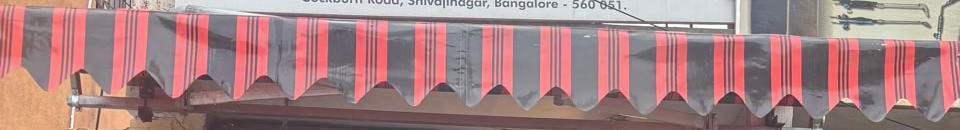 **R01** Awning: scallops, two stripes, rib sag | 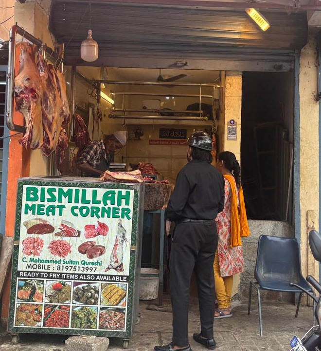 **R02** Shopfront: the composition model for S1 | 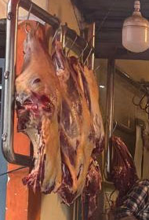 **R03** Meat hung from a bar at the door |
| 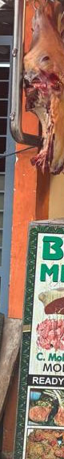 **R04** Orange plaster pillar | 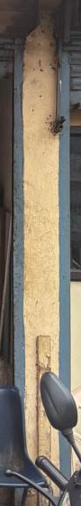 **R05** Cream wall, grime at the base | 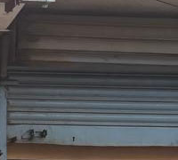 **R06** Rolling shutter, worn blue |
| 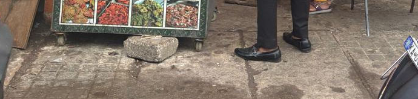 **R07** Paving, broken slab, kerb stone | 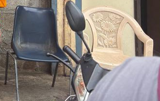 **R08** Navy and cream plastic chairs | 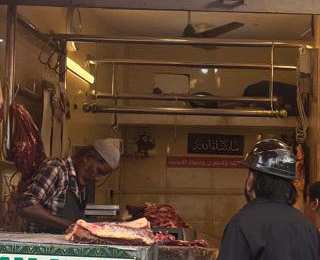 **R09** Interior: rails, tube light, counter |

### Kitchens and counters (F03, F05)

| | | |
|---|---|---|
| 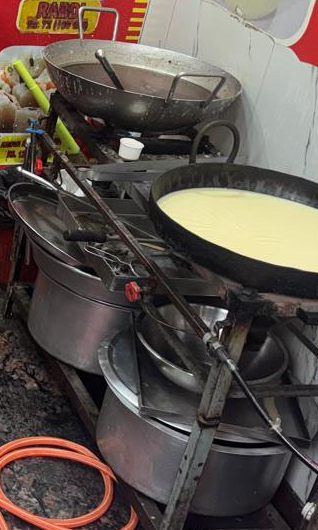 **R10** Steel kadais on burners | 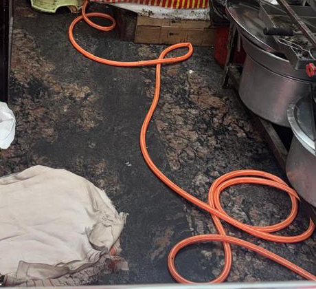 **R11** Orange hose on a wet dark floor | 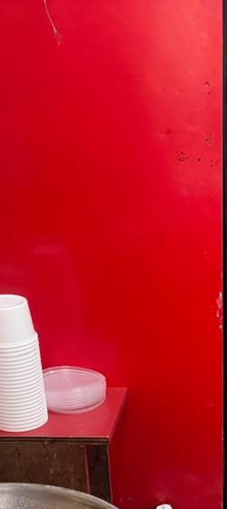 **R12** Red wall (environment red stays dusty, §3.3) |
| 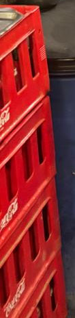 **R13** Red crates, the only crate form we have | 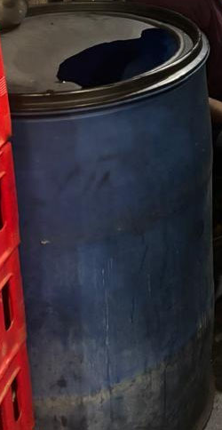 **R14** Blue drum | 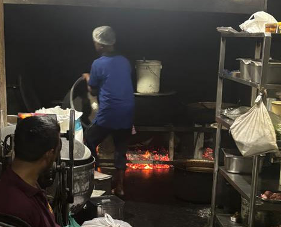 **R15** Charcoal glow and haze |
| 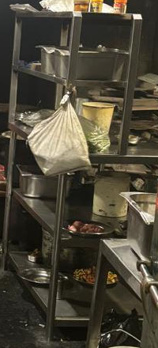 **R16** Open steel rack | 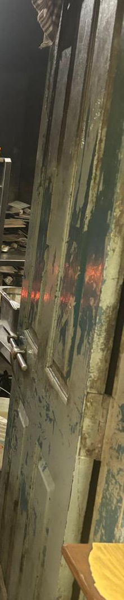 **R17** Worn green painted door | |

### Street (F01, F02)

| | | |
|---|---|---|
| 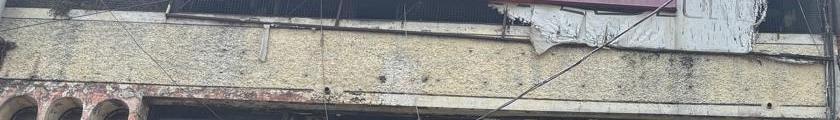 **R18** Stained concrete band | 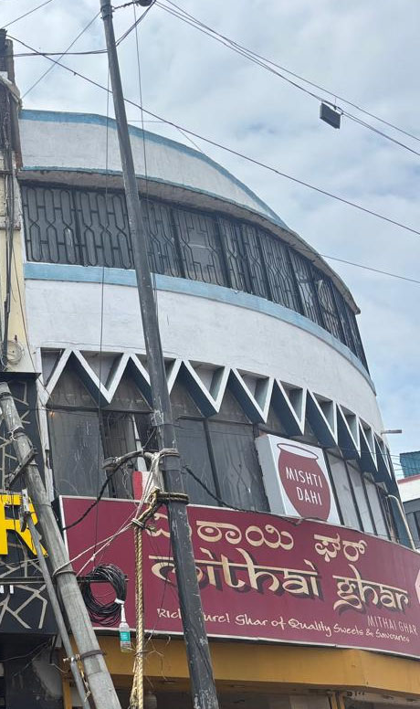 **R19** Wires, pole, curved façade | 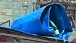 **R20** Blue tarp (pulled down in colour, §3.3) |
| 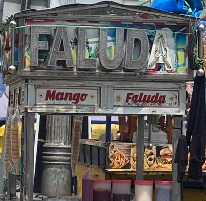 **R21** Steel pushcart | 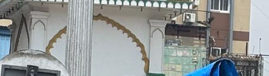 **R22** White-and-green minaret | |

### Russell Market (Tier B, CC BY-SA)

| | |
|---|---|
| 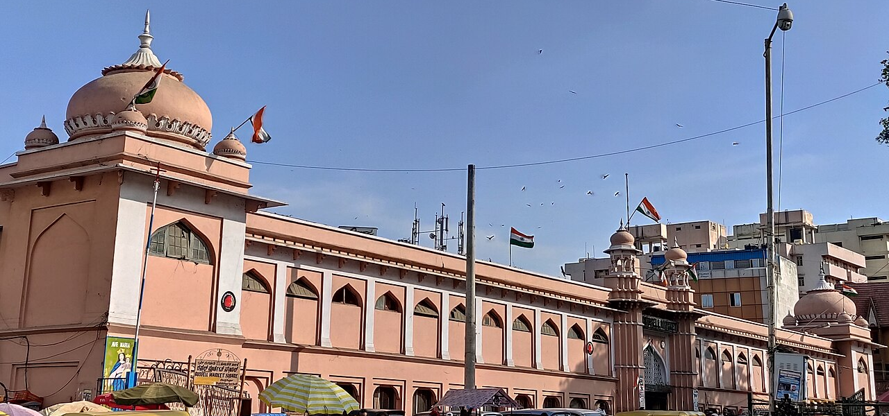 **R23** Façade in 2020, pink (X03, Ahmed Nisar, CC BY-SA 4.0) | 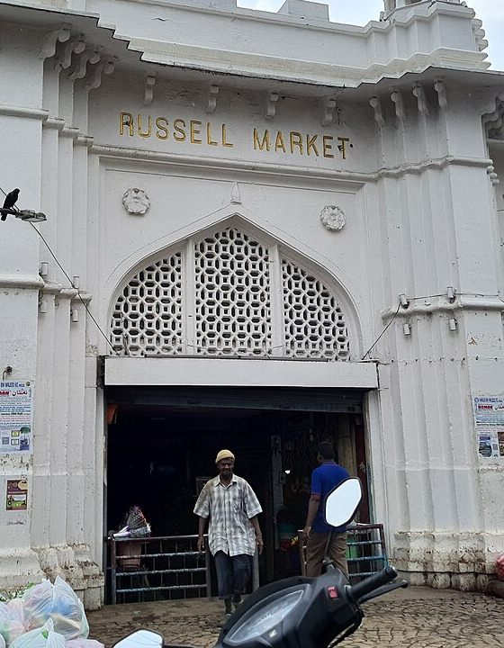 **R24** Entrance in 2023, white, jali arch (X04, Thejeshgn, CC BY-SA 4.0) |
| 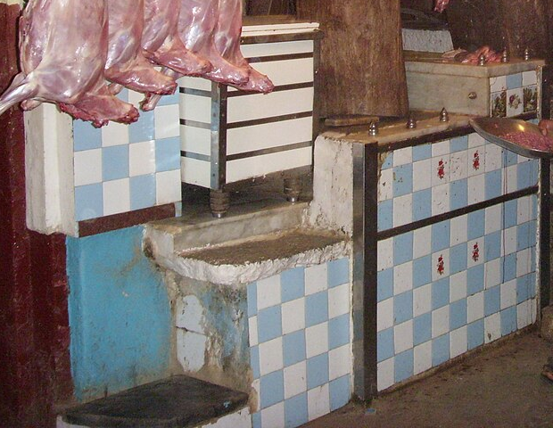 **R25** Checker-tiled meat counters (X05, fraboof, CC BY-SA 2.0) | 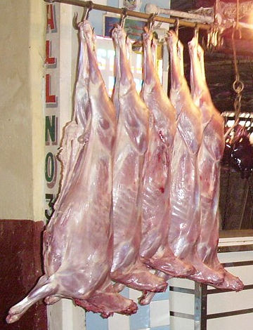 **R26** Carcass rail (X05) |

## 10. Station 1 set breakdown (for the vertical slice)

This is what step 2 builds, with each item's source.

| Element | Built from | Notes |
|---|---|---|
| Shopfront, opening and shutter box | R02, R06 | A 2.4 m opening, the shutter rolled up and showing its housing |
| Awning | R01 | Full width plus 40 cm, the scalloped hem at the front |
| Pillars and walls | R04, R05 | The orange pillar on the left, the cream neighbour on the right |
| Hanging rail and meat | R03, R26 | Left side of the opening, matte, no gore |
| Counter and chopping block | R09, R25, *Five senses: Sound* | Tiled front (X05), wooden block on top; the cleaver is the "morning cut" prop |
| Signboard on the counter | F04 layout | Text from JSON: "Meat corner" plus Kannada; Urdu TODO |
| Fridge | **gap** | A grey box until we find a reference; it flickers in Run 1 |
| Pavement | R07 | Wet sheen in front, one broken slab |
| Chairs, scooter | R08, F04 | `fg` layer at bottom-right, below the blueprint line |
| **The kilo** | F03, F05 (white sacks) | A knotted translucent white plastic bag, 1.3× scale, with the tag on its knot. White on the dark interior gives the strongest contrast in the frame. |
| Riyaz Q. | §7 | Behind the counter, facing the camera's left three-quarter view |

---

### Change log

- 0.1: first draft, from the deck photos and five Commons photos. Open questions: the façade colour (§0) and the colour of Chamber B (§3.2).
